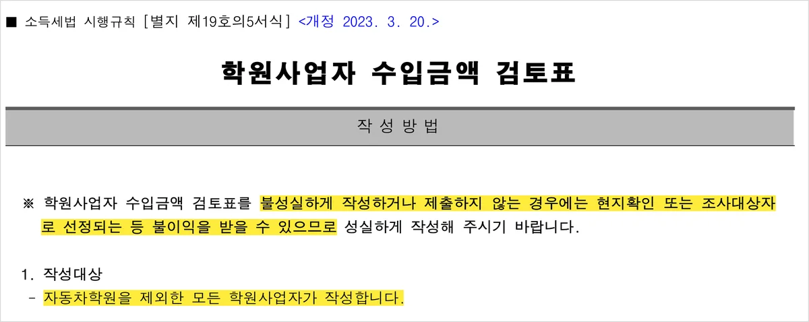

## 학원은 부가세 신고를 하지 않는데, 그럼 세금 신고가 없나요?

부가세 신고가 없을 뿐이고 신고는 두 번 남습니다. 주무관청에 등록하거나 신고한 학원·강습소·교습소에서 가르치는 것은 부가가치세가 면제되는 교육 용역이기 때문에(부가가치세법 제26조 제1항 제6호, 시행령 제36조 제1항), 1월과 7월의 부가세 신고를 하지 않습니다. 그 자리를 **사업장현황신고**가 대신하고, 소득에 매기는 **종합소득세**는 업종과 무관하게 그대로 남습니다.

| 언제 | 무엇을 | 자주 놓치는 것 |
|---|---|---|
| 수강료를 받을 때 | 현금영수증 발급 | 10만원 이상 현금은 요청이 없어도 발급 |
| 강사료를 줄 때 | 원천징수·지급명세서 | 근로자인지 프리랜서인지 구분이 먼저 |
| 다음 해 2월 10일까지 | 사업장현황신고 | 수입금액검토표를 함께 제출 |
| 다음 해 5월 31일까지 | 종합소득세 신고 | 직전 연도 수입 7,500만원부터 복식부기 |

다만 모든 학원이 면세는 아닙니다. 무도학원과 자동차운전학원은 면세되는 교육 용역에서 제외되어 있어(부가가치세법 시행령 제36조 제2항) 일반 과세사업자처럼 부가세를 신고합니다. 간판에 '학원'이 붙었다고 자동으로 면세가 되는 것은 아니므로 사업자등록증의 과세 유형을 먼저 확인해 보시는 편이 좋습니다.

> **면세사업자란?** 공급하는 재화·용역 자체에 부가가치세를 매기지 않는 사업자입니다. 세금계산서 대신 계산서를 발급하고, 매입할 때 부담한 부가세를 돌려받지 못하는 대신 부가세 신고 의무가 없습니다. 소득세·원천세는 과세사업자와 똑같이 적용됩니다.

## 2월 10일까지 하는 사업장현황신고는 무엇인가요?

한 해 동안의 수입금액과 사업장 현황을 과세기간이 끝난 다음 해 2월 10일까지 관할 세무서에 알리는 절차입니다(소득세법 제78조 제1항). 부가세 신고가 없어 국세청이 매출을 확인할 길이 없기 때문에, 면세사업자에게 그 역할을 대신 맡겨 둔 신고라고 보시면 됩니다.

학원은 여기에 **학원사업자 수입금액검토표**를 함께 냅니다(소득세법 시행규칙 별지 제19호의5서식). 반별 수강 인원과 1인당 수강료, 강사 현황을 적는 표인데, 자동차학원을 제외한 모든 학원사업자가 작성 대상입니다.

가산세는 학원에 적용되지 않습니다. 사업장현황신고 불성실 가산세는 의료업·수의업과 약국에만 걸리도록 범위가 정해져 있기 때문입니다(소득세법 제81조의3 제1항, 시행령 제147조의2). 그렇다고 대충 내도 되는 서류는 아닙니다. 서식 안내문에 적힌 대로 검토표를 불성실하게 작성하거나 내지 않으면 현지확인이나 조사 대상 선정으로 이어질 수 있습니다. 검토표에 적은 인원·단가를 거꾸로 곱한 금액이 신고한 수입금액과 크게 어긋나지 않는지, 제출 전에 한 번 맞춰 보시기 바랍니다.

## 5월 종합소득세 신고에서는 무엇이 달라지나요?

학원 소득도 다른 사업소득과 마찬가지로 다음 해 5월 1일부터 31일까지 신고합니다(소득세법 제70조 제1항). 이때 갈리는 것은 세율이 아니라 **장부를 어느 수준으로 쓰느냐**입니다.

| 기준 | 금액 | 결과 |
|---|---|---|
| 직전 연도 수입금액 | 7,500만원 미만 | 간편장부대상자 |
| 직전 연도 수입금액 | 7,500만원 이상 | 복식부기의무자 |
| 해당 연도 수입금액 | 5억원 이상 | 성실신고확인 대상 |

학원은 교육서비스업이라 복식부기 기준선이 가장 낮은 7,500만원 구간에 들어갑니다(소득세법 시행령 제208조 제5항 제2호 다목). 성실신고확인 대상이 되는 금액도 같은 구간의 5억원입니다(시행령 제133조 제1항 제3호). 수강생이 조금만 늘어도 기준을 넘기기 쉬운 편이어서, 매출이 7,000만원 선에 닿았다면 다음 해 장부를 미리 준비해 두시는 쪽이 안전합니다.

## 수강료를 현금으로 받으면 현금영수증을 꼭 끊어야 하나요?

건당 10만원 이상이면 발급해야 합니다. 학원은 현금영수증 의무발행업종이어서, 상대방이 요청하지 않아도 발급 의무가 생깁니다(소득세법 제162조의3 제4항, 시행령 별표 3의3).

학부모 휴대전화 번호를 받지 못한 경우에도 넘어갈 수 없습니다. 현금을 받은 날부터 ==5일 이내==에 무기명으로, 즉 국세청이 정한 번호로 발급하면 의무를 지킨 것이 됩니다(소득세법 시행령 제210조의3 제13항).

빠뜨리면 가산세 부담이 큽니다. 미발급 금액의 **20%**가 그대로 붙고, 착오나 누락이어서 대금을 받은 날부터 10일 안에 자진 신고하거나 자진 발급하면 10%로 줄어듭니다(소득세법 제81조의9 제2항 제3호). 수강료 300만원을 현금으로 받고 영수증을 끊지 않았다면 60만원이 가산세인 셈이니, 할인해 준 금액보다 훨씬 큰 부담이 됩니다.

교육서비스업 사업자가 수강료를 현금으로 받으면서 자체 영수증만 써 주었다가 미발급 가산세를 맞은 결정도 있습니다. 조세심판원은 의무를 몰랐다는 사정만으로 가산세를 면할 정당한 사유가 되지는 않는다고 보았습니다(조심 2026소2411).

## 강사료는 어떻게 처리해야 하나요?

먼저 그 강사가 **근로자인지 프리랜서인지** 가립니다. 정해진 시간에 출근하고 학원의 지휘·감독을 받으면 근로소득으로 보아 간이세액표에 따라 원천징수하고(소득세법 제134조 제1항), 수업 단위로 계약해 독립적으로 일하면 사업소득으로 보아 3%를 원천징수합니다(소득세법 제129조 제1항 제3호). 지방소득세까지 더해 흔히 3.3%라고 부르는 그 세율입니다.

계약서 제목만으로 정해지지는 않습니다. 국세청도 근로소득인지 사업소득인지는 실제 근무 형태에 따라 판단할 사항으로 보았습니다(소득세과-0673). 4대보험 가입 여부와 퇴직금 문제까지 함께 걸리는 부분이라, 강사가 여러 명이라면 계약 형태를 한 번 정리해 두시는 편이 낫습니다.

원천징수한 내역은 2월 사업장현황신고 때 내는 검토표의 강사 현황과도 맞물립니다. 검토표에 적은 강사 수·급여가 실제 원천세 신고분과 어긋나면 수입금액 쪽도 함께 들여다보게 되므로, 두 자료를 같은 기준으로 맞춰 두시기 바랍니다.

## 자주 묻는 질문

### 교습소나 공부방도 사업장현황신고를 해야 하나요?

교육청에 신고한 교습소 역시 면세사업자이므로 2월 10일까지 사업장현황신고를 합니다. 집에서 운영하는 개인과외교습도 현금영수증 의무발행업종인 일반교습학원에 해당한다고 본 국세청 해석이 있습니다(기준-2019-법령해석소득-0613).

### 수강료를 카드로만 받으면 현금영수증은 신경 쓰지 않아도 되나요?

카드로 결제받은 금액은 카드 매출로 잡히므로 현금영수증 발급 대상이 아닙니다. 의무는 현금으로 받은 건당 10만원 이상의 거래에 생깁니다. 다만 일부를 현금으로 받는 경우가 섞여 있다면 그 건만 따로 챙기셔야 합니다.

### 학원 매출이 적어도 사업장현황신고를 해야 하나요?

네. 사업장현황신고는 금액 기준이 없고, 과세기간 중에 휴업하거나 폐업한 사업자도 포함됩니다(소득세법 제78조 제1항). 수입이 없었다면 없는 대로 신고하시면 됩니다.

### 태권도장이나 피아노 학원도 면세인가요?

주무관청에 등록·신고된 학원이나 교습소에서 가르치는 것이라면 면세되는 교육 용역에 들어갑니다. 반대로 등록 없이 운영하는 시설은 면세로 보기 어렵고, 무도학원과 자동차운전학원은 등록했더라도 면세에서 빠집니다(부가가치세법 시행령 제36조).
