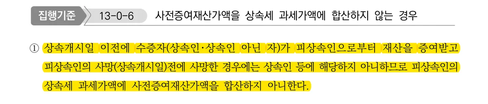
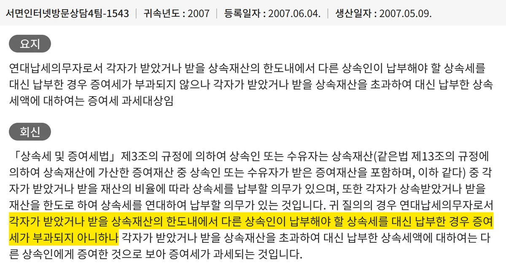
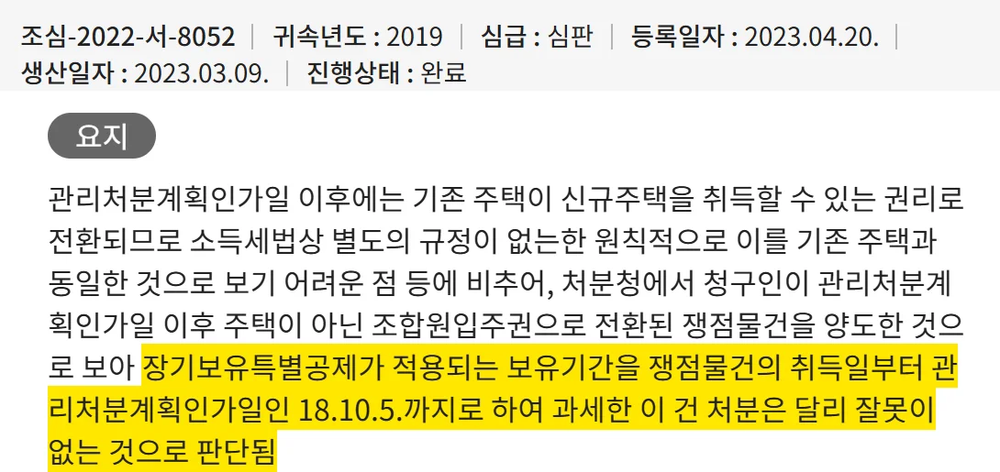

## 상속 순서에 따라 상속세가 얼마나 달라지나요?

같은 재산이라도 2억원 넘게 달라질 수 있습니다. 아래는 재산 24억원(재건축을 추진하는 아파트 18억원, 세를 준 상가 5억원, 예금 1억원)이 모두 아버지 명의이고 자녀가 3명인 집을 단순 계산한 결과입니다.

| 경우 | 아버지 상속 때 | 어머니 상속 때 | 가족 전체 |
|---|---|---|---|
| ① 아버지가 먼저, 어머니가 상가·예금 6억원을 받음 | 약 3.41억원 | 약 776만원 | 약 3.49억원 |
| ② 아버지가 먼저, 어머니는 받지 않음 | 약 3.80억원 | 없음 | 약 3.80억원 |
| ③ 재산이 없는 어머니가 먼저 | 약 5.74억원 | 없음 | 약 5.74억원 |

계산 조건: 일괄공제 5억원, 금융재산공제 2천만원(예금 1억원의 20%), 신고세액공제 3%만 반영했고 장례비·채무 등은 뺐습니다. ①에서 어머니가 받은 6억원은 법정상속분 한도(24억원 × 1.5/4.5 = 8억원) 안이라 전액 배우자상속공제가 됩니다. 2026년 11월 기준 세율로 계산했습니다.

## 왜 배우자가 먼저 돌아가시면 세금이 늘어나나요?

남은 한 분의 상속 때 배우자상속공제를 받을 사람이 없어지기 때문입니다. 배우자가 있으면 받은 재산이 없어도 5억원, 받은 재산이 있으면 그 금액을 법정상속분 한도와 30억원 중 작은 금액까지 공제합니다(상속세 및 증여세법 제19조 제1항·제4항). 배우자가 없으면 일괄공제 5억원(제21조 제1항)과 금융재산공제 정도만 남습니다.

③에서 과세표준이 18.8억원까지 올라가 40% 구간에 더 많이 걸리는 것이 차이의 원인입니다. 재산이 두 분에게 나뉘어 있다면 이 차이는 줄어듭니다.

> **배우자상속재산분할기한이란?**
> 배우자상속공제를 5억원보다 많이 받으려면, 상속세 신고기한의 다음 날부터 9개월이 되는 날까지 배우자가 받을 재산을 분할하고 등기·명의개서를 끝내야 합니다(같은 법 제19조 제2항).

## 어머니가 먼저 돌아가실 경우를 미리 대비할 수 있나요?

배우자에게 미리 증여해 두는 방법이 있습니다. 배우자에게 10년간 6억원까지는 증여세가 없고(같은 법 제53조 제1호), 증여받은 분이 증여한 분보다 먼저 돌아가시면 그 증여재산은 나중 상속 때 다시 더하지 않습니다(상속증여세 집행기준 13-0-6).

위 예시에서 아버지가 상가·예금 6억원을 어머니께 증여한 뒤 어머니가 먼저 돌아가시면, 어머니 상속은 일괄공제와 배우자상속공제로 0원, 아버지 상속은 아파트 18억원만 남아 약 3.49억원이 됩니다. ③보다 약 2.25억원 적습니다(증여 때 내는 취득세는 반영하지 않았습니다).

반대로 증여 후 10년 안에 **아버지가 먼저** 돌아가시면 그 6억원은 상속재산에 다시 더해집니다(같은 법 제13조 제1항 제1호). 이 경우 절세 효과 없이 취득세만 더 낸 결과가 될 수 있으므로, 두 순서를 모두 계산해 보고 정해야 합니다.

## 상가처럼 임대 중인 부동산은 평가를 어떻게 하나요?

시가가 없으면 임대료를 환산한 금액과 기준시가 중 큰 금액으로 평가하는 것이 원칙입니다(같은 법 제60조 제3항, 제61조 제5항). 예시에서 상가가 5억원이 아니라 2억원으로 평가되면 ② 기준 상속세가 약 1.2억원 줄어듭니다.

다만 같은 건물의 비슷한 상가가 높은 값에 거래된 사례가 있으면 그 가격이 시가로 쓰일 수 있고(제60조 제2항), 상속 때 낮게 잡은 평가액이 그대로 상가의 취득가액이 되므로 나중에 팔 때 양도소득세 부담이 커질 수 있습니다(소득세법 시행령 제163조 제9항). 상속세와 양도세를 함께 놓고 평가 방법을 정해야 합니다.

## 상속세 낼 현금이 부족하면 어떻게 하나요?

연부연납과 상속인 간 대신 납부를 함께 검토합니다.

| 방법 | 내용 |
|---|---|
| 연부연납 | 납부세액이 2천만원을 넘으면 담보를 제공하고 나눠 낼 수 있습니다. 일반 상속재산은 허가일부터 최대 10년, 각 회분이 1천만원을 넘어야 합니다(같은 법 제71조 제1항·제2항) |
| 대신 납부 | 상속인은 각자 받은 재산을 한도로 상속세를 연대해 낼 의무가 있습니다(같은 법 제3조의2 제3항). 그 한도 안에서 다른 상속인 몫을 내 주는 것은 증여세 대상이 아니라는 국세청 회신이 있습니다 |

받은 재산을 넘는 금액을 대신 내면 그 초과분은 증여로 봅니다. 배우자가 받은 재산 범위 안에서 자녀 몫을 내 주면 배우자 재산이 그만큼 줄어, 뒤이은 상속에서 상속재산도 줄어듭니다.

## 재건축 아파트는 언제 파느냐도 세금에 영향이 있나요?

있습니다. 관리처분계획인가를 받으면 세법상 주택이 아니라 조합원입주권이 되고(소득세법 제88조 제9호), 원조합원이 입주권을 팔 때 장기보유특별공제는 관리처분계획인가 전 양도차익에만 적용됩니다(같은 법 제95조 제2항).

| 단계 | 금액 |
|---|---|
| 취득가액 | 3억원 |
| 관리처분계획인가 당시 | 15억원 |
| 입주권 양도가액 | 18억원 |
| 장기보유특별공제를 받지 못하는 부분 | 인가 뒤 오른 3억원 |

상속세 재원을 마련하려고 아파트를 먼저 팔 계획이라면, 인가 전후의 세금 차이를 비교한 뒤 시기를 정하는 것이 좋습니다. 상속 뒤에도 1+1 분양 여부에 따라 상속주택 특례를 달리 본 국세청 해석이 있으므로(사전-2015-법령해석재산-0439, 서면-2022-법규재산-4203), 조합에 분양을 신청할 때부터 이 부분을 같이 따져 봐야 합니다.

## 미리 상담할 때는 어떤 서류가 필요한가요?

다음 자료가 있으면 두 순서의 예상 상속세를 미리 계산할 수 있습니다.

| 확인할 것 | 자료 | 쓰이는 곳 |
|---|---|---|
| 재산과 명의 | 등기부, 재산세 고지서, 예금 잔액 | 상속재산 평가 |
| 임대 부동산 | 임대차계약서, 인근 거래 사례 | 평가 방법 선택 |
| 받을 사람 | 가족 간 협의 내용, 유언 공정증서 | 배우자공제, 다음 상속 |
| 상속인 주택 | 상속인 세대의 주택 보유 현황 | 상속 후 양도세·취득세 |
| 재건축 진행 | 정비계획, 조합 공지 | 입주권 전환 시점 |
| 10년 내 증여 | 증여세 신고서 | 사전증여 합산 |

## 자주 묻는 질문

### 어머니가 아무것도 상속받지 않아도 배우자상속공제가 되나요?

됩니다. 배우자 몫이 0원이거나 5억원에 못 미쳐도 공제액은 5억원으로 정해져 있습니다(상속세 및 증여세법 제19조 제4항). 5억원을 넘게 공제받으려면 배우자 몫을 실제로 나누고 기한 안에 등기까지 마쳐야 합니다.

### 배우자에게 6억원을 증여하면 항상 상속세가 줄어드나요?

그렇지 않습니다. 증여한 분이 10년 안에 먼저 돌아가시면 그 재산은 상속세 계산에 다시 더해지고, 증여 때 낸 취득세만 남을 수 있습니다. 누가 먼저 돌아가시는지 두 경우를 모두 계산해 본 뒤 결정해야 합니다.

### 상속인 한 명이 다른 형제의 상속세까지 내면 증여세가 나오나요?

자신이 받은 상속재산 범위 안에서 대신 낸 것이라면 증여세가 부과되지 않습니다(서면인터넷방문상담4팀-1543). 받은 재산을 넘어서 대신 낸 부분은 증여로 보아 과세됩니다.

### 상속세는 언제까지 내야 하나요?

상속개시일이 속한 달의 말일부터 6개월 안에 신고·납부해야 합니다(같은 법 제67조 제1항, 제70조 제1항). 현금이 부족하면 연부연납 신청을 함께 검토합니다.
