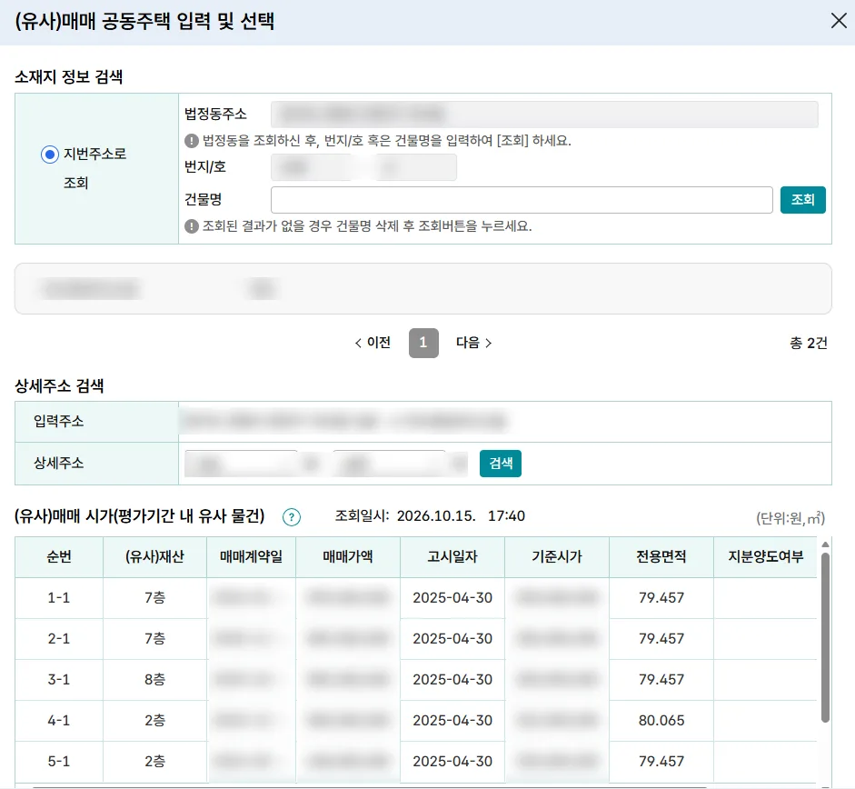
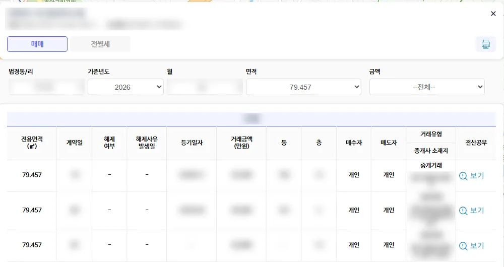

## 상속세가 0원인데도 늦게나마 신고할 이유가 있나요?

나중에 그 집을 팔 때의 취득가액이 상속 시점의 평가액으로 굳어지기 때문입니다. 상속받은 자산은 산 값이 따로 없으므로, 상속개시일 현재 상속세 및 증여세법으로 매긴 가액을 취득 당시의 실지거래가액으로 봅니다. 세무서장이 결정하거나 경정한 가액이 있으면 그 금액이 기준이 됩니다(소득세법 시행령 제163조 제9항).

즉 신고를 하지 않고 두면 공시가격 수준으로 결정될 수 있고, 그 낮은 금액이 몇 년 뒤 양도세 계산의 출발점이 됩니다. ==상속세가 0원인 것과, 평가액을 제대로 남기는 것은 별개의 문제입니다.==

> **기한후신고란?** 법정신고기한을 넘겨 신고서를 내는 것입니다. 상속세처럼 신고기한이 지난 뒤에도 세무서의 결정 통지 전이면 낼 수 있습니다.

## 기한후신고는 언제까지 낼 수 있나요?

관할 세무서장의 결정 통지가 나가기 전이라면 낼 수 있습니다(국세기본법 제45조의3 제1항). 통지가 이미 도착했다면 그때는 길이 막힙니다.

세무서가 상속세를 결정해야 하는 기한(법정결정기한)은 상속세 과세표준 신고기한부터 9개월입니다(상속세 및 증여세법 시행령 제78조 제1항 제1호). 그 안에 언제든 통지가 올 수 있으므로, 팔 계획이 잡혀 있다면 시간이 넉넉하다고 보기 어렵습니다.

## 같은 단지에 거래가 여러 건이면 어느 가격이 시가인가요?

고르는 순서가 법에 박혀 있어 납세자가 유리한 쪽을 임의로 집을 수는 없습니다. 평가대상 주택 자체에 매매나 감정 가액이 없다면, 면적과 공동주택가격이 비슷한 단지 내 다른 주택의 거래가를 시가로 봅니다(상속세 및 증여세법 시행령 제49조 제4항).

| 순서 | 기준 |
|---|---|
| 대상 범위 | 같은 공동주택단지 안, 주거전용면적 차이 5% 이내, 공동주택가격 차이 5% 이내 |
| 1순위 | 그중 평가대상 주택과 공동주택가격 차이가 가장 작은 집 |
| 2순위 | 평가기준일 전후로 가장 가까운 날의 거래(매매계약일로 판단) |
| 같은 날이 둘 이상 | 그 가액들의 평균 |

범위 요건은 상속세 및 증여세법 시행규칙 제15조 제3항 제1호에, 가까운 날과 매매계약일 기준은 같은 법 시행령 제49조 제2항에 있습니다. 평가기간은 상속개시일 전후 6개월입니다.

## 홈택스 조회 결과를 그대로 써도 되나요?

목록에서 누락되는 거래가 있어 한 번 더 확인하셔야 합니다. 홈택스의 상속·증여재산 평가하기 메뉴에 소재지를 입력하면 평가기간에 속한 유사 거래가 순번과 함께 표시됩니다.

최근 맡은 사례에서 이 화면의 첫 줄은 6억원 거래였습니다. 같은 단지를 국토교통부 실거래가 공개시스템에서 다시 조회하자, 그 목록에는 없던 다른 동의 거래가 하나 더 잡혔습니다. 금액은 6억 8,000만원, 공동주택가격은 평가대상 주택과 동일했고, 계약일이 상속일로부터 170일쯤 뒤라 평가기간을 벗어나지 않았습니다. 규정의 순서를 그대로 적용하면 1순위는 이 거래였습니다.

국세청 안내에도 계약일 이후 자료가 실리기까지 시간이 걸려 조회일 기준 2개월 안쪽 거래는 빠진다는 설명이 있습니다. 다만 이 건은 그 범위보다 앞선 거래인데도 화면에 나타나지 않았습니다. 그래서 등기사항증명서로 호수와 금액을 확인하고 공동주택가격과 함께 신고서의 근거로 붙였습니다.

반대 방향의 사례도 있습니다. 두 곳 어디에도 나오지 않던 같은 단지 거래를 세무서가 찾아내 시가로 과세한 건에서, 조세심판원은 거래가 공시·등록되어 있어야 한다는 요건은 없다고 보아 과세를 유지했습니다(조심 2025서1821). ==조회 화면에 없다고 해서 그런 거래가 없었던 것은 아닙니다.==

## 시가를 어떻게 잡느냐로 양도세가 얼마나 벌어지나요?

매도가가 동일해도 취득가액이 바뀌면 결과는 크게 벌어집니다. 위 사례에서 상속받은 지분 1/2만 떼어 계산하면 다음과 같습니다.

| 상속세 신고 방식 | 취득가액(상속 지분) | 양도세(지방소득세 포함) |
|---|---|---|
| ① 신고하지 않아 공시가격으로 결정 | 1억 8,000만원 | 5,226만 1,000원 |
| ② 홈택스 화면 맨 위 거래(6억원) | 3억원 | 884만 4,000원 |
| ③ 실제 1순위 거래(6억 8,000만원) | 3억 4,000만원 | 150만 1,500원 |

상속받은 지분의 양도가를 3억 6,000만원으로 두고, 비과세에 해당하지 않으며 필요경비와 장기보유특별공제를 빼고 기본공제 250만원만 적용한 단순 계산입니다. ①과 ③의 간격은 약 5,076만원, ②와 ③ 사이도 약 734만원입니다. 셋 모두 납부할 상속세는 0원입니다.

## 기한후신고 전에 무엇부터 확인하나요?

| 확인할 것 | 어디서 | 이유 |
|---|---|---|
| 결정 통지가 왔는지 | 관할 세무서 | 통지 전이어야 기한후신고가 됩니다 |
| 평가기간 | 상속개시일 기준 | 전후 6개월 안의 거래만 봅니다 |
| 같은 단지 거래 | 홈택스·국토교통부 실거래가 | 한쪽에만 올라온 거래가 있습니다 |
| 공동주택가격 | 부동산공시가격 알리미 | 5% 요건과 1순위 판단에 씁니다 |
| 거래 호수·금액 | 등기사항증명서 | 신고서에 붙일 근거가 됩니다 |
| 상속세가 생기는지 | 재산·채무·사전증여 내역 | 시가를 올려도 0원인지 확인합니다 |

## 자주 묻는 질문

### 상속세 기한후신고는 기한이 따로 있나요?

날짜로 정해진 기한이 아니라 세무서의 결정 통지 시점이 경계입니다. 상속세 결정기한이 신고기한부터 9개월이므로 그 사이에 통지가 올 수 있고, 통지를 받으면 기한후신고는 불가능합니다.

### 기한후신고를 할 때도 신고한 날까지의 거래만 따지나요?

신고일까지의 가액으로 자르는 괄호 부분은 법정신고기한 내에 신고서를 낸 경우를 전제로 한 규정입니다(상속세 및 증여세법 시행령 제49조 제4항). 대법원은 증여세 사건에서 이 제한이 기한을 지킨 납세자의 예측 가능성을 보장하려는 취지라고 판단했습니다(대법원 2025두30271). 기한을 넘겨 내는 신고에까지 같은 제한이 걸린다고 단정하기는 어려우므로, 평가기간 전체를 놓고 순위를 따져 보는 쪽이 무난합니다.

### 양도세 신고는 상속세 신고 전에 해도 되나요?

상속세 결정 통지를 확인한 다음에 하시는 편이 낫습니다. 세무서의 결정가액이 곧 취득가액이 되기 때문에, 양도세를 먼저 신고해 두면 뒤늦게 수정해야 하는 일이 생길 수 있습니다.

### 부동산이 지방에 있어도 의뢰할 수 있나요?

네, 가능합니다. 기한후신고와 양도소득세 신고 모두 소재지와 무관하게 처리됩니다.
