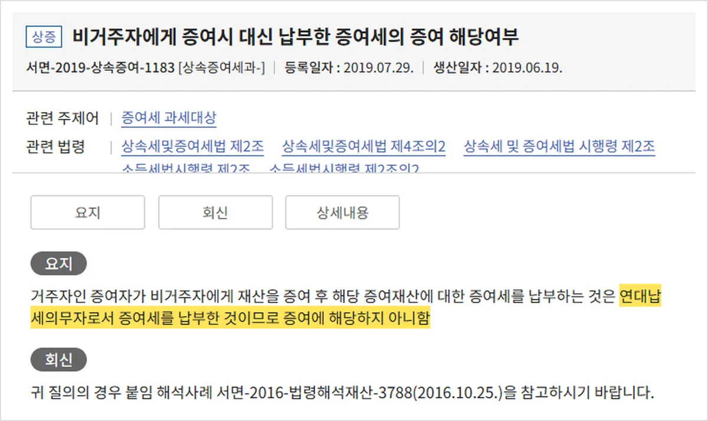

## 해외에 오래 살면 바로 비거주자가 되나요?

그렇지 않습니다. 국적이나 체류 국가가 아니라 생활의 무게중심이 어디에 있는지로 갈립니다.

세법에서 거주자는 국내에 주소가 있거나 183일 이상 거소를 둔 사람이고, 그렇지 않은 사람이 비거주자입니다(상속세 및 증여세법 제2조 제8호). 주소가 국내에 있는지는 국내에서 생계를 함께하는 가족이 있는지, 국내에 자산이 있는지 같은 생활관계의 객관적 사실로 따집니다(소득세법 시행령 제2조 제1항).

| 구분 | 이렇게 보는 쪽 |
|---|---|
| 183일 이상 국내에 있어야 하는 직업이 있다 | 거주자 |
| 국내에 생계를 같이하는 가족이 있고, 직업·자산으로 보아 183일 이상 국내에 살 것으로 인정된다 | 거주자 |
| 내국법인이 지분 전부를 가진 현지법인이나 국외사업장으로 보낸 임직원, 국외에서 일하는 공무원 | 거주자 |
| 외국 국적·영주권이 있으면서 국내에 생계를 같이하는 가족이 없고, 직업·자산으로 보아 다시 들어와 살 것으로 보이지 않는다 | 비거주자 |

표의 앞 세 줄은 소득세법 시행령 제2조 제3항과 제3조, 마지막 줄은 같은 영 제2조 제4항이 정한 기준입니다. 유학이나 주재원처럼 어느 쪽에도 딱 떨어지지 않는 경우에는 가족·자산·직업을 묶어 전체로 판단하게 되고, 그래서 판정 자체가 쟁점이 되기도 합니다. 판정 시점은 증여일 현재입니다(서면-2016-법령해석재산-3788).

## 부모가 대신 낸 증여세가 왜 증여가 아닌가요?

증여세를 내야 하는 사람은 원칙적으로 재산을 받은 쪽입니다(상속세 및 증여세법 제4조의2 제1항). 다만 받는 사람이 비거주자이면 증여한 쪽에도 그 세금을 함께 낼 의무가 따로 생깁니다(같은 조 제6항 제3호).

> **연대납세의무란?** 같은 세금에 대해 두 사람이 각자 전액을 낼 책임을 지는 것을 말합니다. 비거주자에게 증여하면 증여한 부모가 그 책임을 함께 지게 됩니다.

부모가 낸 돈이 ==자녀 대신 내준 것이 아니라 부모 자신의 의무를 이행한 것==이므로, 그 금액은 자녀가 새로 받은 이익으로 보지 않습니다. 국세청 집행기준과 질의회신도 같습니다(상속증여세 집행기준 36-0-2, 서면-2019-상속증여-1183). 세무서에서 연대납세의무자 지정 통지를 받기 전에 먼저 납부한 경우에도 결론은 달라지지 않습니다(서면-2016-법령해석재산-3788).

대신 비거주자 자녀는 받을 때의 조건이 여러 가지로 달라집니다.

| 항목 | 거주자 자녀 | 비거주자 자녀 |
|---|---|---|
| 과세되는 증여재산 | 국내·국외 모든 재산 | 국내에 있는 재산 |
| 증여재산공제(성년 자녀) | 10년간 5천만원 | 없음 |
| 부모가 증여세를 대신 내면 | 그 금액도 증여 | 증여가 아님 |
| 신고하는 세무서 | 자녀 주소지 관할 | 부모 주소지 관할 |

근거는 상속세 및 증여세법 제4조의2 제1항, 제6조 제2항 제1호, 제53조입니다.

## 국내에 사는 자녀일 때는 어떻게 다른가요?

대신 내주는 것 자체는 할 수 있지만, 그 금액에 증여세가 다시 붙습니다.

자녀가 거주자이고 주소가 분명하며 세금을 낼 능력도 있는 보통의 경우에는 부모에게 연대납세의무가 없습니다. 그래서 부모가 대신 낸 세금은 자녀가 갚아야 할 돈을 면한 이익이 되어 증여재산으로 잡힙니다(상속세 및 증여세법 제36조 제1항, 상속증여세 집행기준 36-0-2). 게다가 10년 안에 같은 사람에게 받은 증여는 합산하므로, 대신 내줄 때마다 앞선 증여에 더해져 세율 구간이 올라갑니다(같은 법 제47조 제2항, 서면인터넷방문상담4팀-731).

그래서 거주자 자녀라면 세금을 대신 내주기보다, ==증여세로 낼 현금까지 처음부터 함께 증여하고 자녀가 그 돈으로 직접 납부==하는 쪽이 정리가 깔끔합니다.

## 비거주자 쪽이 세금이 더 적게 나오나요?

꼭 그렇지 않습니다. 자녀 손에 같은 금액을 남긴다는 기준으로 맞춰 보면 결과가 거의 붙습니다.

성년 자녀에게 현금을 증여하고 10년 안에 다른 증여가 없으며 기한 안에 신고한 경우로, 자녀에게 3억원이 남도록 계산한 단순 비교입니다.

| 경우 | 부모가 쓴 돈 | 증여세 | 자녀에게 남는 돈 |
|---|---|---|---|
| 거주자 자녀, 자녀가 직접 납부 | 3억원 | 3,880만원 | 2억 6,120만원 |
| 거주자 자녀, 세금 낼 돈까지 함께 증여 | 약 3억 4,814만원 | 약 4,814만원 | 3억원 |
| 비거주자 자녀, 부모가 대신 납부 | 3억 4,850만원 | 4,850만원 | 3억원 |

과세표준 1억원 초과 5억원 이하 구간의 세율 20%(누진공제 1천만원)와 신고세액공제 3%를 적용했습니다(상속세 및 증여세법 제26조·제56조·제69조 제2항). 비거주자는 대신 내준 세금이 다시 증여가 되지 않는 대신 공제 5천만원을 못 받아 처음 세액이 커지고, 거주자는 공제를 받는 대신 세금 몫까지 증여해야 해서 증여액이 늘어납니다. 두 효과가 서로 상쇄되어 2026년 기준으로 ==차이가 36만원 남짓==에 머뭅니다.

금액대가 달라지거나 10년 안에 이미 받은 증여가 있으면 적용 세율이 바뀌어 순서가 뒤집힐 수 있으므로, 실제 숫자로 따로 따져 보셔야 합니다.

## 비거주자인데도 대신 낸 돈이 증여가 되는 경우가 있나요?

있습니다. 크게 세 가지를 조심하시면 됩니다.

첫째, **증여한 사람이 아닌 다른 가족이 내는 경우**입니다. 할머니가 증여한 재산의 세금을 아버지가 내면 아버지에게는 연대납세의무가 없으므로, 그 금액은 손주가 받은 증여가 됩니다(재산세과-181).

둘째, **국외에 있는 재산을 증여하는 경우**입니다. 거주자가 비거주자에게 해외 주택이나 해외 계좌를 증여하면 증여세를 낼 의무가 처음부터 증여자에게 있습니다(국제조세조정에 관한 법률 제35조 제2항). 대납인지를 따질 국면 자체가 아닙니다.

셋째, **연대납세의무가 배제되는 증여 유형**입니다. 상속세 및 증여세법 제4조의2 제6항 단서는 저가 양수·고가 양도(제35조), 채무면제(제36조) 등을 연대납세의무 대상에서 빼 두었습니다. 같은 비거주자 증여라도 재산을 넘기는 방식에 따라 결론이 갈립니다.

## 자주 묻는 질문

### 비거주자 자녀에게 증여하면 어느 세무서에 신고하나요?

받는 사람이 비거주자일 때는 관할이 증여자 쪽으로 옮겨가, 부모 주소지 세무서가 과세합니다(상속세 및 증여세법 제6조 제2항 제1호). 기한은 거주자일 때와 같습니다.

### 해외에 사는 손주에게 할머니가 증여하면 세금도 할머니가 낼 수 있나요?

손주가 비거주자면 증여자인 할머니에게 연대납세의무가 따르므로, 할머니가 낸 세금은 손주의 증여재산으로 잡히지 않습니다(상속세 및 증여세법 제4조의2 제6항 제3호). 다만 한 세대를 건너뛴 증여여서 산출세액에 30%가 붙을 수 있고, 이 세금을 손주의 부모가 내면 그 금액은 증여가 됩니다(재산세과-181).

### 자녀가 거주자인지 비거주자인지 애매하면 어떻게 하나요?

증여를 실행하기 전에 출입국 기록, 현지 직업·거주 자료, 국내에 남은 가족과 자산 현황을 모아 판정부터 받아 보시는 편이 안전합니다. 판정 결과에 따라 공제 가능 여부, 대납 처리, 신고할 세무서가 모두 달라지기 때문입니다.
