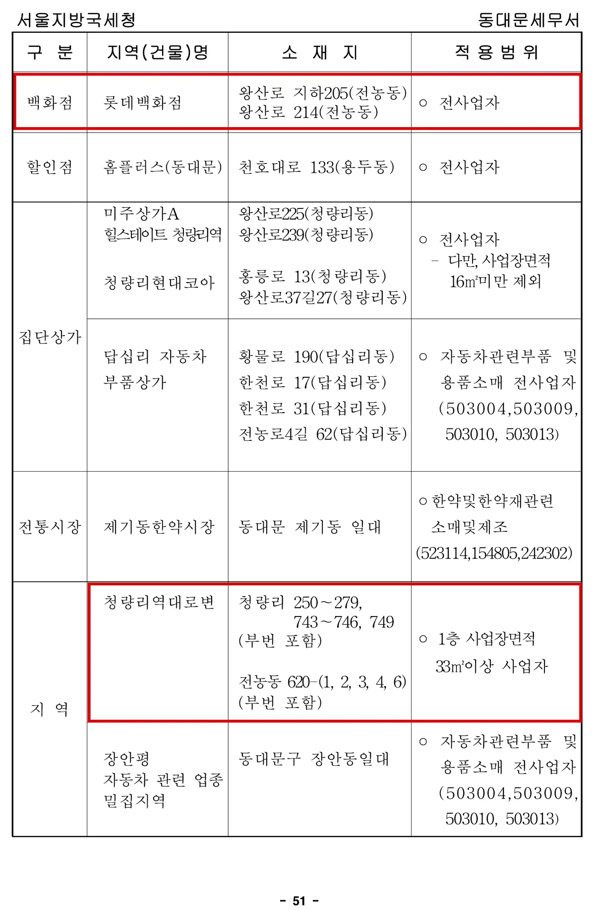

## 간이과세자가 되는 기준은 무엇인가요?

직전 연도 공급대가의 합계가 **1억 400만원에 못 미치는 개인사업자**가 여기에 해당합니다. 법은 "8천만원부터 그 130%까지의 범위에서 대통령령으로 정하는 금액"이라고만 두었고(제61조 제1항), 시행령이 그 금액을 1억 400만원으로 정해 두었습니다(시행령 제109조 제1항).

> **공급대가란?** 부가가치세까지 포함해 손님에게서 받은 금액 전체를 말합니다. 부가세를 뺀 공급가액과는 다릅니다.

법인에는 이 규정이 적용되지 않아 규모와 무관하게 일반과세자로 출발합니다. 개인이 새로 사업을 시작한다면 사업자등록 신청서와 함께 간이과세 적용 신고서를 내면 됩니다(제61조 제3항·제4항).

개업 첫해는 매출이 1년치가 아니므로 **12개월로 환산해서** 판정합니다(제61조 제2항). 환산 결과가 기준금액에 이르면 이듬해 상반기까지는 간이과세자로 두었다가 7월 1일 자로 유형이 바뀝니다. 10월 하순 개업해 석 달 동안 2,600만원을 올렸다면 환산액이 꼭 기준선에 닿으므로, 다음 해 하반기부터 일반과세자가 됩니다.

## 두 유형은 실제로 무엇이 다른가요?

| 구분 | 간이과세자 | 일반과세자 |
|---|---|---|
| 대상 | 직전 연도 공급대가 1억 400만원 미만 개인 | 1억 400만원 이상 개인 · 법인 · 배제 업종·지역 |
| 신고 횟수 | 1년 1회 (다음 해 1월) | 1년 2회 (1월·7월) |
| 세액 계산 | 공급대가 × 업종별 부가가치율 × 10% | 매출세액 − 매입세액 |
| 세금계산서 | 첫해 또는 직전 연도 공급대가 4,800만원 미만이면 영수증만 | 세금계산서 발급 |
| 환급 | 없음 | 있음 |
| 납부의무 면제 | 과세기간 공급대가 4,800만원 미만이면 면제 | 없음 |

간이과세자의 과세표준은 공급대가 전체이고(제63조 제1항), 여기에 업종별 부가가치율을 곱한 뒤 10%를 적용해 납부세액을 구합니다(제63조 제2항). 해당 과세기간 공급대가가 **4,800만원 미만이면 납부의무 자체가 면제**됩니다(제69조 제1항).

세금계산서 쪽은 제한이 있습니다. 직전 연도 공급대가가 4,800만원 미만인 간이과세자와, 신규 개업해 간이과세자로 보는 최초 과세기간 중인 사업자는 세금계산서 대신 영수증을 발급해야 합니다(제36조 제1항 제2호). 거래처가 주로 사업자라면 이 점이 걸림돌이 될 수 있습니다.

## 세금을 합치면 얼마나 차이 나나요?

부가세만 보면 차이가 커 보이지만, 종합소득세까지 합치면 폭이 줄어듭니다. 간이과세자는 부가세를 덜 내는 만큼 장부상 이익이 커져 소득세를 조금 더 내기 때문입니다.

| 상황 (부가세 포함 금액) | 간이과세자 | 일반과세자 | 차이 |
|---|---|---|---|
| 매출 6,000만원 · 매입 2,200만원 | 약 530만원 | 약 752만원 | 간이가 약 222만원 적음 |
| 매출 4,000만원 · 매입 1,500만원 | 약 249만원 | 약 439만원 | 간이가 약 190만원 적음 |
| 매출 4,000만원 · 매입 1,500만원 + 개업 첫해 인테리어 3,300만원 | 약 140만원 | 약 40만원 | 일반이 약 100만원 적음 |

※ 종합소득세는 지방소득세를 포함한 금액이며, 다른 소득 없이 본인 기본공제만 반영했습니다. 신용카드 매출 세액공제와 의제매입세액공제는 넣지 않았고, 인테리어는 5년에 나눠 비용으로 처리한 단순 계산입니다.

세 번째 줄만 결론이 뒤집히는 까닭은 환급에 있습니다. 매입세액이 매출세액을 웃돌 때 일반과세자는 그 초과분을 돌려받지만, 간이과세자에게는 돌려받는 길 자체가 없습니다. 다만 둘째 해부터는 다시 간이과세자 쪽이 연 200만원 안팎 유리해지므로, 첫해 한 번의 환급액과 이후 몇 해분 차액을 함께 놓고 보셔야 합니다.

## 매출이 기준 아래인데도 간이과세가 막히는 경우가 있나요?

있습니다. 법은 "업종, 규모, 지역 등을 고려하여 대통령령으로 정하는 사업자"는 간이과세자로 보지 않는다고 정했고(제61조 제1항 제2호), 그 구체적인 목록이 **국세청 간이과세 배제기준 고시**입니다.

배제 기준은 두 갈래입니다.

- **업종 기준** — 서울에서는 귀금속·시계 소매, 골프·등산·스포츠 의류 소매, 일정 면적을 넘는 치킨·피자·김밥 전문점 등이 어느 건물에 있든 배제됩니다.
- **지역·건물 기준** — 세무서별로 백화점·할인점·집단상가·전통시장과 특정 지번 구역이 지정되어 있습니다. 같은 동네라도 건물마다 결론이 갈립니다.

위 캡처는 고시 별표4의 동대문세무서 부분입니다. 롯데백화점처럼 건물 이름이 올라간 곳은 입점 사업자 전원이 배제되고, '청량리역 대로변'처럼 지번으로 묶인 구역은 1층 사업장 면적 33㎡ 이상이라는 식으로 조건이 붙기도 합니다. 본인 사업장이 여기에 걸리는지는 사업자등록 전에 관할 세무서에 확인하시는 편이 확실합니다.

## 고시 목록은 고정되어 있나요? (2026년 기준)

아닙니다. 이 고시에는 재검토 기한이 정해져 있고, 2026년만 해도 1월과 7월 두 차례 바뀌었습니다. 지금 목록에 없는 건물이 다음 고시에서 추가될 수 있고, 그렇게 되면 간이과세자로 시작했더라도 이후 일반과세자로 전환될 수 있습니다. 새로 문을 여는 대형 상업시설에 입점할 계획이라면, 계약 시점의 최신 고시를 다시 확인하셔야 합니다.

## 자주 묻는 질문

### 간이과세자는 부가세 신고를 아예 안 해도 되나요?

납부의무가 면제되는 것과 신고의무가 없는 것은 다릅니다. 공급대가가 4,800만원 미만이라 납부할 세액이 없더라도, 다음 해 1월에 신고는 해야 합니다.

### 간이과세자로 시작했는데 매출이 늘면 언제 바뀌나요?

직전 연도 공급대가가 기준금액 이상이 된 해의 **다음 해 7월 1일**부터 일반과세자로 적용받습니다. 1월 1일에 바로 바뀌는 것이 아니라 상반기는 간이과세자로 남습니다.

### 개업 투자가 큰데 배제 지역이라 간이과세를 못 하면 손해인가요?

꼭 그렇지는 않습니다. 인테리어·장비 매입세액을 환급받을 수 있으므로, 투자 규모가 크다면 일반과세자 쪽이 첫해에는 오히려 유리할 수 있습니다.
